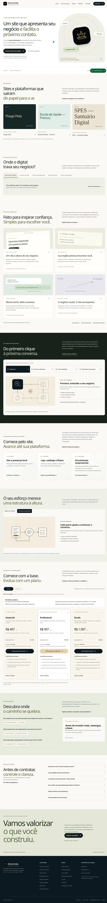
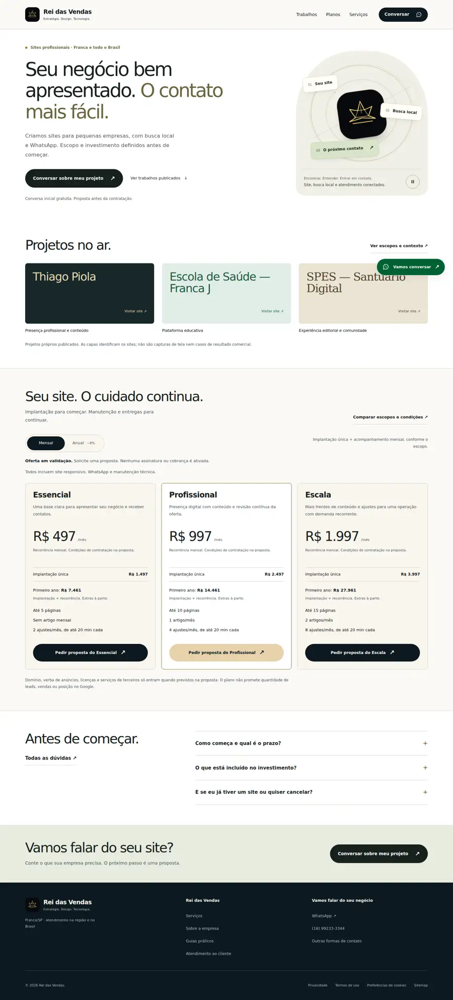

# Home objetiva — evidência de execução

Data: 30/10/2026. Base: 03334475350bc4a2b6f688476dc72279b202054c. Mesmo repositório tpiola/reidasvendas e projeto Vercel prj_pcMEMsQCigN8NVGVqm8uiWgSSLVL. Solicitação explícita do dono: reduzir conteúdo e executar de ponta a ponta.

## Resultado e motivo

A home passou de 11 para cinco seções: oferta, projetos próprios publicados, investimento, três dúvidas e convite para conversa. Foram retirados da home tabs de intenção, catálogo ilustrado, diagramas de método, ecossistema/protótipo, comparação conceitual e quiz. O conteúdo útil permanece nas rotas específicas; não há promoção da plataforma em desenvolvimento na home. A fonte comercial dos planos não mudou.

Menu principal: cinco para três destinos. Rodapé: quatro para três colunas com menos links, mantendo contato, atendimento, informações legais e preferências de cookies. Planos: uma variante compacta na home; mensal/anual, implantação, total do primeiro ano e contexto do CTA preservados. A página /planos mantém comparação e condições completas. A ordem de leitura oferece prova e investimento sem exigir ferramentas interativas.

Aparência: branco, coroa e fonte existente; títulos menores abaixo do hero; capas e coroa menores no celular; espaçamento entre seções de 64px desktop e 40px mobile. Não foi reduzida a área de toque para encurtar a página. Layout avaliado por dois auxiliares isolados, um visual e outro mecânico, com escrita exclusiva de /root. O detector detect.mjs não existe no pacote instalado: execução retornou MODULE_NOT_FOUND, nenhuma aprovação automática foi atribuída. Busca de classes Tailwind de espaçamento arbitrário sem achados; revisão visual, lint, orçamento, axe e oito larguras complementam a avaliação.

## URLs e jornada

Nenhum slug ou redirect novo. Preservados /casos, /planos, /servicos e os redirects de compatibilidade anteriores. CTA geral → /diagnostico. CTA de plano → /diagnostico?plano=...&ciclo=..., resumo revisável e WhatsApp. A escolha não ativa assinatura nem cobrança; planos continuam em validação comercial. Não foram enviados contatos, mensagens ou pagamentos.

## Verificação local

Ambiente: Next 16.4.2, React 19.3.1, pnpm 11.25.0; build de produção. Playwright com Chromium 153 disponível no ambiente. Os testes iniciam o servidor no próprio processo. Revisão das práticas React: página e preço continuam server components; sem novos efeitos, dependências ou requisições; componentes interativos desnecessários deixam o bundle inicial da home.

| Verificação | Resultado |
|---|---|
| pnpm check | aprovado |
| pnpm lint | aprovado |
| pnpm test | 59 aprovados, seis arquivos |
| pnpm build | aprovado, 61 entradas geradas |
| pnpm budget | aprovado; home JS moderno gzip 145.149 B (antes 149.901 B), CSS 19.726 B, HTML 9.988 B |
| pnpm e2e | 39 aprovados, 19,7s na execução final completa |
| Responsividade | 320, 360, 375, 390, 414, 768, 1024 e 1440px sem overflow nos controles verificados |
| Acessibilidade automatizada | nove superfícies axe sem violações nos critérios testados; teclado, FAQ e pausa/reduced motion aprovados |
| Preços e continuidade | três planos nos dois ciclos, totais anuais e links com contexto verificados; anual sem JavaScript preservado |
| Lighthouse mobile home | 97, 98, 98; LCP 2.033/1.794/1.765ms; CLS 0 em todas; mediana dentro dos portões |
| pnpm audit --prod | nenhuma vulnerabilidade conhecida |
| pnpm audit | oito avisos herdados, dev-only em @lhci/cli: seis altos, um moderado, um baixo; dependências/lockfile inalterados |

Um teste novo de overflow no diagnóstico identificou o campo antispam propositalmente fora da tela. O helper foi corrigido para excluir somente esse campo oculto; nenhum campo visível foi dispensado. Os testes antigos específicos dos widgets removidos da home foram substituídos por navegação, FAQ por teclado, custos dos três planos em ambos os ciclos e avanço direto ao resumo. Simulador/quiz continuam testados em /simulador.

O coletor Lighthouse manteve nove relatórios anteriores em sua pasta. A tabela e lighthouse.json contam exclusivamente as três novas execuções da home na porta 3001. A validação usa a mediana, sem apagar a medição de 2.033ms. Resultados de laboratório não comprovam INP de campo, conversão ou receita.

## Inspeção visual

Antes: home ao vivo, largura 1363px, 11.299px de altura e 1.586 palavras visíveis no conteúdo principal, em estado de FAQ fechado e preços mensais. Captura completa preservada. Depois local: desktop 1440x3176px; mobile 390x5476px. As larguras do antes/depois diferem, portanto não se atribui uma porcentagem exata de redução de altura a essas capturas. A contagem de seções (11 → 5) é diretamente comparável. Capturas posteriores foram inspecionadas completas e em viewport.

## Limites e publicação

A publicação será realizada no projeto existente somente com CI aprovado; confirmar READY, SHA e domínio após a integração. O commit anterior permanece disponível para rollback pelo provedor. Condições comerciais definitivas, processador de cobrança e plataforma autenticada continuam dependências. Esta entrega prepara a recepção de pedidos de proposta; aumento de conversão depende de medição real posterior.
